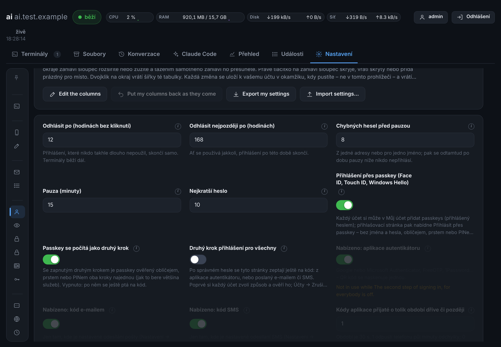
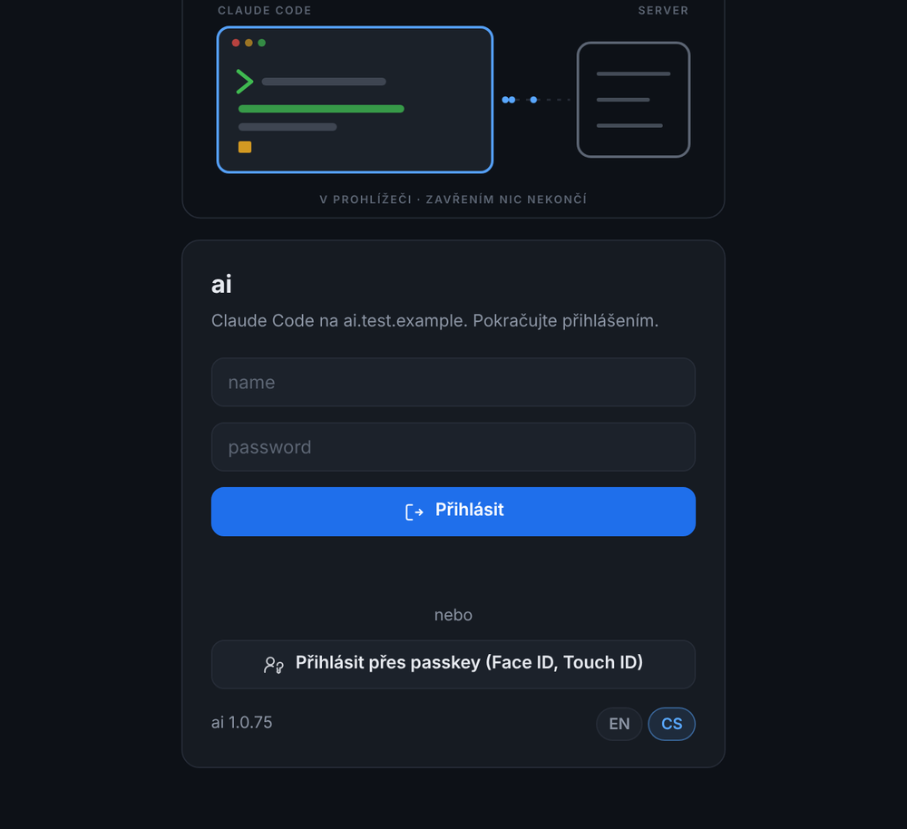
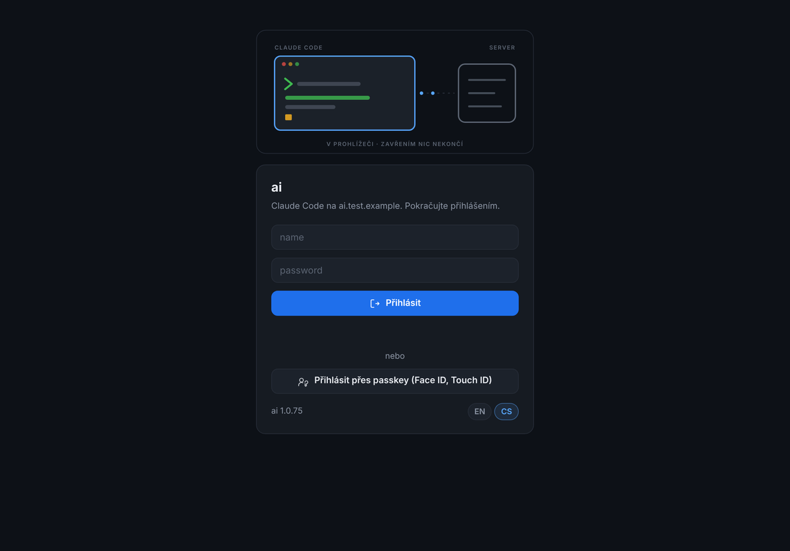
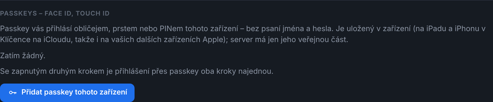
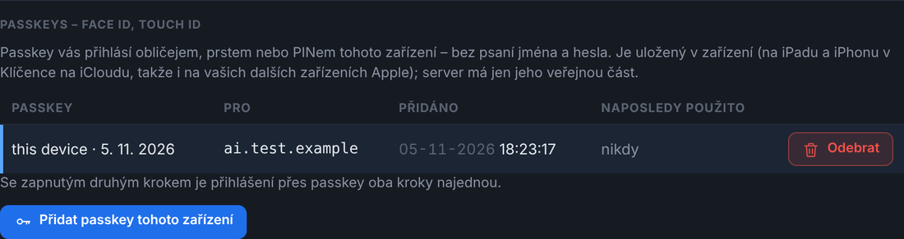
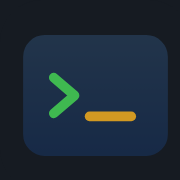
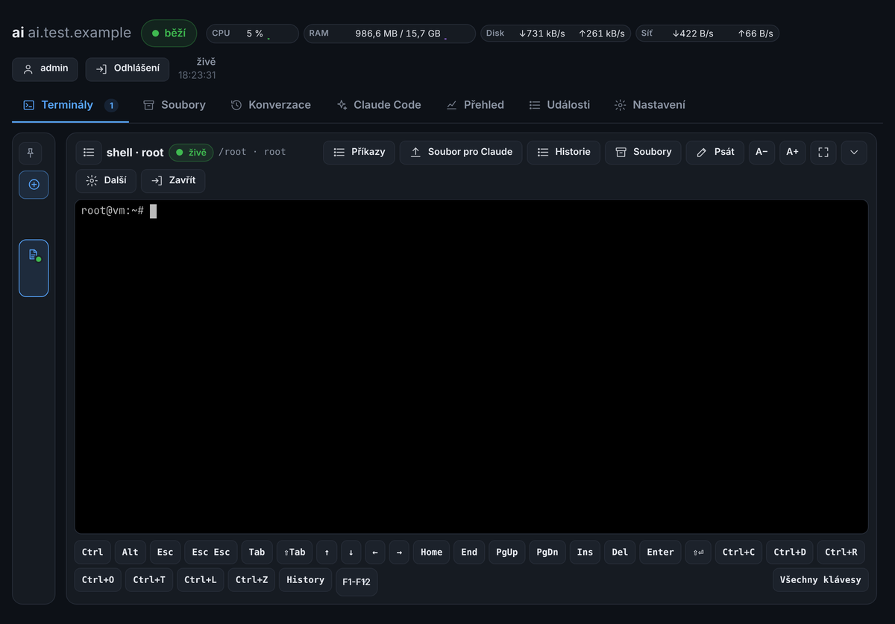
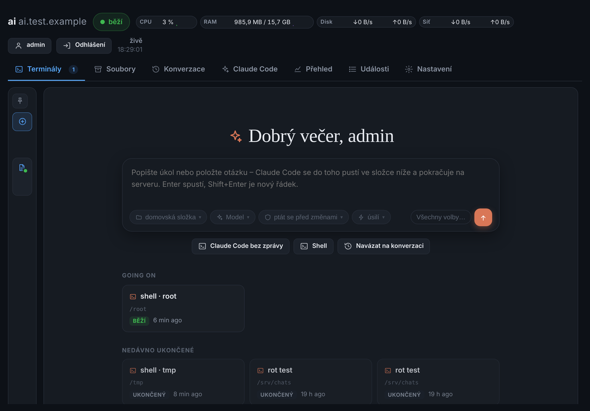
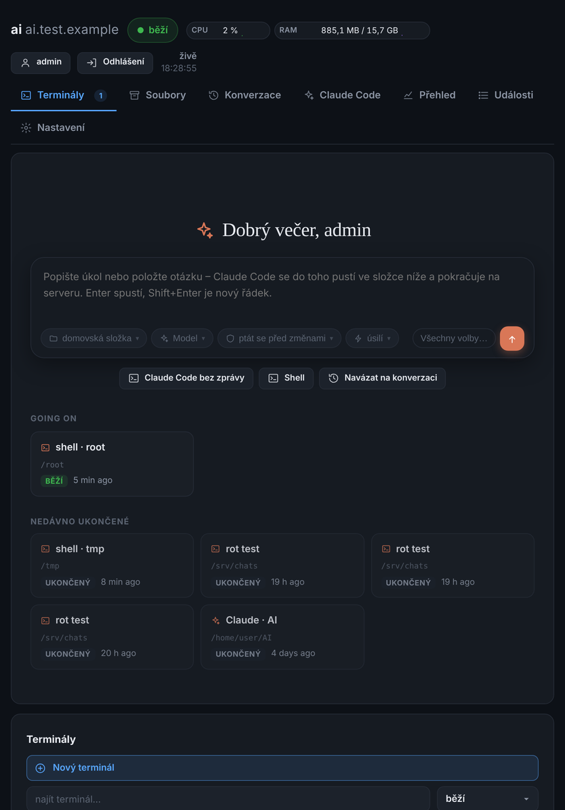

# Face ID (passkeys) a iPad: specifikace k převzetí do jiné aplikace

Tento dokument popisuje, jak jsou v aplikaci **ai** udělané čtyři věci, aby je šlo převzít do jiné webové
aplikace:

1. **přihlášení přes Face ID / Touch ID / Windows Hello** (passkeys, WebAuthn),
2. **zástupce na ploše iPadu s vlastní ikonou** (aplikace na ploše bez lišt Safari),
3. **celá obrazovka** (fullscreen) na iPadu, včetně návratu Safari do normálního stavu,
4. **další úpravy pro iPad**: klávesnice na obrazovce, otočení na výšku/šířku, posouvání úvodní stránky,
   najetí myší vs. klepnutí prstem.

Je to popis toho, co v ai skutečně běží a co bylo otestováno (verze 1.0.70–1.0.76). Ke každé části je
uvedeno *co*, *proč* a *jak*, i s úryvky kódu a vzhledem obrazovek. Kód je psaný bez knihoven a bez
build kroku (čistý JS v prohlížeči, server v Pythonu se standardní knihovnou a openssl). Do jiného
jazyka nebo frameworku se dá převést jedna ku jedné.

Základní pravidla, která platí pro všechno níže:

- **Funkce navíc se nesmí dotknout ničeho stávajícího.** Účet bez passkey se přihlašuje přesně jako dřív.
  Zástupce na ploše nic nemění v prohlížeči. Úpravy pro iPad se zapínají jen na iPadu nebo iPhonu.
- **Passkeys jsou ve výchozím stavu vypnuté** a zapíná je administrátor v nastavení aplikace. Dokud jsou
  vypnuté, server žádnou passkey nenabídne ani nepřijme. Přihlašovací stránka tlačítko nezobrazí a ve
  Vašem účtu je tlačítko „Přidat“ neaktivní a vedle něj je vysvětlení proč.

---

## 1. Přihlášení přes Face ID / Touch ID (passkeys, WebAuthn)

### 1.1 Jak to vidí uživatel

1. Administrátor zapne v **Nastavení → Účty** přepínač *Přihlášení přes passkey (Face ID, Touch ID,
   Windows Hello)*.
2. Uživatel se jednou normálně přihlásí jménem a heslem a otevře **Váš účet**. V sekci
   *Passkeys – Face ID, Touch ID* klikne na **Přidat passkey tohoto zařízení**. iPad se zeptá na Face ID
   a passkey se uloží do Klíčenky na iCloudu, takže funguje i na jeho iPhonu a Macu.
3. Příště na přihlašovací stránce stačí kliknout na **Přihlásit přes passkey (Face ID, Touch ID)**. Jméno
   ani heslo se nepíše, stačí pohled do kamery.
4. Je-li zapnutý druhý krok přihlášení (TOTP/e-mail/SMS) a zároveň volba *Passkey se počítá jako druhý
   krok* (výchozí), je passkey ověřená obličejem oba kroky najednou. Když je tato volba vypnutá, zeptá se
   aplikace po passkey ještě na kód.

### 1.2 Podmínky (bez nich passkey nefunguje)

| Podmínka | Proč |
|---|---|
| **HTTPS s certifikátem, kterému prohlížeč věří** (Let's Encrypt, firemní CA nainstalovaná v zařízení) | WebAuthn jinak v prohlížeči vůbec není dostupné. |
| **Stránky otevřené přes jméno**, např. `https://ai.firma.cz/`, ne přes IP adresu | WebAuthn neumí passkey svázat s IP adresou. Passkey je svázaná s tímto jménem (RP ID). |
| Stejné jméno při přidání i při přihlášení | Passkey přidaná na `ai.firma.cz` nefunguje na `10.0.0.5` ani na `jiny.firma.cz`. |
| Na iPadu zapnutá **Klíčenka na iCloudu** (Nastavení → [jméno] → iCloud → Hesla a klíčenka) | Bez ní iPad nabízí jen bezpečnostní klíč nebo QR kód jiného zařízení. |

Aplikace všechny tyto podmínky kontroluje a srozumitelně je hlásí. Na IP adrese se tlačítko na
přihlašovací stránce vůbec neukáže a ve Vašem účtu se objeví hláška „Passkey se přidává na stránkách
otevřených přes jméno přes HTTPS (https://jméno/), ne přes adresu.“

**Pozor, iPad a 1Password:** když je v iPadu nastavený 1Password (nebo jiný správce hesel) jako
poskytovatel passkeys, nabídne iPad při přidávání passkey 1Password místo Face ID. Nejde o chybu
aplikace. Uživatel to přepne v **Nastavení iPadu → Obecné → Automatické vyplňování a hesla**: buď tam
nechá zapnutá jen *Hesla (Klíčenka na iCloudu)*, nebo při přidávání zvolí *Jiné možnosti → Uložit do
Klíčenky*. Passkey uložená v 1Password funguje také, jen se místo Face ID otevře 1Password, který se
Face ID odemyká.

### 1.3 Nastavení (dvě volby)

| Klíč | Typ | Výchozí | Název v UI | Popis v UI |
|---|---|---|---|---|
| `passkeys` | bool | **false** | Přihlášení přes passkey (Face ID, Touch ID, Windows Hello) | Každý účet si může ve Vašem účtu přidat passkeys (musí být přihlášený heslem). Přihlašovací stránka pak nabídne *Přihlásit přes passkey*: bez jména a hesla, obličejem, prstem nebo PINem zařízení. Jen na stránkách otevřených přes jméno s certifikátem, kterému prohlížeč věří. Dokud je volba vypnutá, žádná passkey se nenabídne ani nepřijme. |
| `passkey_is_2fa` | bool | **true** | Passkey se počítá jako druhý krok | Se zapnutým druhým krokem je passkey ověřená obličejem, prstem nebo PINem oba kroky najednou (tak to bere většina služeb). Vypnuto: po passkey se aplikace ještě zeptá na kód. *Ukazuje se jen při zapnutém `passkeys`.* |



### 1.4 Co server ukládá

Jeden seznam (v ai je to JSON v tabulce `meta` pod klíčem `passkeys`). **Nic z toho není tajné**: server
má jen veřejnou část klíče.

```json
[{
  "id": "base64url ID přihlašovacích údajů (credential ID)",
  "user": "jméno účtu",
  "name": "iPad · 5. 11. 2026",
  "pem": "-----BEGIN PUBLIC KEY-----\n...\n-----END PUBLIC KEY-----\n",
  "alg": -7,
  "count": 0,
  "created": 1762366997.1,
  "last_used": 0,
  "host": "ai.firma.cz",
  "backed_up": true
}]
```

- `alg`: −7 = ES256 (Apple, Google, většina klíčů), −257 = RS256 (Windows Hello), −8 = EdDSA.
- `count`: čítač podpisů. Passkeys z Klíčenky na iCloudu posílají vždy 0, hardwarové klíče ho zvyšují.
- `backed_up`: příznak BS z authenticatorData (passkey se synchronizuje přes iCloud a podobně).
- Nejvýš **20 passkeys na účet**.
- Výzvy (challenge) se drží jen v paměti, **5 minut** a **jednorázově**.

### 1.5 API (4 + 2 volání)

Všechna volání jsou `POST`/`GET` s JSON. Binární data se posílají jako **base64url bez `=`**.

**Přidání passkey** (uživatel musí být přihlášený), `POST /api/auth/passkey/register`:

```jsonc
// 1) {"step": "begin"} → server vrátí volby pro navigator.credentials.create()
{"publicKey": {
  "challenge": "<32 náhodných bajtů, base64url>",
  "rp": {"id": "ai.firma.cz", "name": "ai · ai.firma.cz"},
  "user": {"id": "<16 bajtů sha256('ai-user:'+jméno), base64url>", "name": "admin", "displayName": "admin"},
  "pubKeyCredParams": [{"type":"public-key","alg":-7},{"type":"public-key","alg":-8},{"type":"public-key","alg":-257}],
  "authenticatorSelection": {"residentKey": "required", "requireResidentKey": true, "userVerification": "required"},
  "excludeCredentials": [{"type": "public-key", "id": "<id už přidaných passkeys tohoto účtu>"}],
  "attestation": "none", "timeout": 300000}}

// 2) {"step": "finish", "name": "iPad · 5. 11. 2026", "clientDataJSON": "…", "attestationObject": "…"}
//    → {"message": "passkey je přidaná – příště se s ní přihlaste", "passkeys": [ … ]}
```

**Přihlášení** (bez přihlášení), `POST /api/auth/passkey/begin` a pak `POST /api/auth/passkey/login`:

```jsonc
// begin: {} → {"publicKey": {"challenge": "…", "rpId": "ai.firma.cz", "userVerification": "required",
//                            "allowCredentials": [], "timeout": 300000}}
//   allowCredentials je prázdné: prohlížeč sám nabídne passkeys, které pro toto jméno má (discoverable).
// login: {"id": "…", "clientDataJSON": "…", "authenticatorData": "…", "signature": "…", "userHandle": "…"}
//   → {"who": {…účet…}, "mfa": ""}   a nastaví se session cookie (jako u přihlášení heslem)
//   → {"who": null, "mfa": "app"}    když je potřeba ještě druhý krok (passkey_is_2fa = false)
```

**Správa**:
- `GET /api/auth/passkeys` vrátí passkeys přihlášeného účtu.
- Administrátor může použít `?name=JMÉNO` (jen tohoto účtu) nebo `?all=1` (všech účtů).
- Odpověď: `{"passkeys": [...bez pem...], "on": bool, "is_2fa": bool, "here": "jméno serveru"}`.
- `POST /api/auth/passkeys` s `{"do": "rename"|"delete", "id": "…", "name": "…"}` passkey přejmenuje
  nebo odebere. Cizí passkey smí měnit jen administrátor.

Když je `passkeys` vypnuté, vrací všechna čtyři volání přidání a přihlášení **403** s hláškou
„passkeys jsou na tomto serveru vypnuté“.

### 1.6 Kontroly na serveru (kontrolní seznam, nic z něj nevynechat)

**Při přidání (`finish`):**
1. `clientDataJSON` dekódovat jako JSON. Musí platit `type == "webauthn.create"`.
2. `challenge` musí být mezi čekajícími výzvami. Hned se **odebere** (jednorázová), musí být druhu
   `register`, starší než 5 min se zamítá a musí patřit **stejnému účtu**, který začal.
3. `origin` musí být `https://<host>` a host musí být jméno, pro které byla výzva vydána.
4. `attestationObject` je CBOR mapa a z ní se vezme `authData`.
5. `authData[0:32] == sha256(host)` (rpIdHash).
6. Příznaky `authData[32]`:
   - **UP (0x01)**: uživatel byl přítomen.
   - **UV (0x04)**: ověřen obličejem, prstem nebo PINem. **Bez UV zamítnout**, jinak by to nebyl druhý
     krok.
   - **AT (0x40)**: jsou přiloženy údaje o klíči.
7. Čítač je `authData[33:37]` (big-endian).
8. Z `authData[37+16+2 …]` se vezme credential ID (jeho délka je v `[53:55]`) a za ním COSE klíč (CBOR).
9. COSE → PEM (SubjectPublicKeyInfo):
   - **ES256** (`kty=2, alg=-7, crv=1`): prefix
     `3059301306072a8648ce3d020106082a8648ce3d030107034200` + `04` + x + y.
   - **RS256** (`kty=3, alg=-257`): SEQUENCE(n, e) v BIT STRING za
     `300d06092a864886f70d0101010500`. Min. 2048 bitů.
   - **EdDSA** (`kty=1, alg=-8, crv=6`): `302a300506032b6570032100` + x.
10. Attestation se **neověřuje** (`attestation: "none"`). Pro přihlášení do vlastní aplikace to stačí a je
    to tak i doporučeno.
11. Do událostí (audit) zapsat „X přidal passkey (název) pro host“.

**Při přihlášení (`login`):**
1. Omezení pokusů podle `passkey:<id>` a IP adresy (stejný mechanismus jako u špatného hesla).
2. Zkontrolovat `clientDataJSON`: `type == "webauthn.get"`, výzva je jednorázová, druhu `login`, nejvýš
   5 min stará, a `origin` sedí.
3. Najít passkey podle `id`. Neznámou zamítnout se zprávou „tato passkey tu není známá (odebraná, nebo
   z jiného serveru)“ a zapsat událost.
4. Zkontrolovat `authData`: rpIdHash, **UP a UV**.
5. **Podpis** se ověřuje nad `authenticatorData || sha256(clientDataJSON)`. ai to dělá přes
   `openssl dgst -sha256 -verify key.pem -signature sig.bin` (ES256 i RS256). Ed25519 má vlastní
   ověření. Jakákoli knihovna (`cryptography`, `webauthn`, `@simplewebauthn/server`, …) udělá totéž.
6. Čítač: když je uložený i poslaný nenulový a poslaný **není větší**, zamítnout jako „čítač passkey šel
   zpět, mohla být zkopírovaná“ a zapsat událost se závažností *bad*.
7. Účet musí existovat a nesmí být vypnutý. V režimu údržby se smí přihlásit jen administrátor.
8. Druhý krok: když je zapnutý 2FA a `passkey_is_2fa` vypnuté, vrátit `mfa: <stage>` a session vydat
   jako nedokončenou.
9. Vytvořit session (do session uložit i `passkey: id`) a aktualizovat `count`, `last_used` a
   `last_login` účtu.
10. Zapsat událost: „X se přihlásil z IP přes passkey (název) – počítá se jako druhý krok“.

**RP ID** je vždy jméno, přes které uživatel stránku otevřel (hlavička `Host`, bez portu). V ai ho PHP
relay předává daemonu v hlavičce `X-Ai-Host`. IP adresa jako RP ID se zamítá hned na serveru.

### 1.7 Kód v prohlížeči

Pomocné funkce pro base64url ↔ ArrayBuffer:

```js
function pkBytes(s) {            // base64url → ArrayBuffer
  s = String(s || '').replace(/-/g, '+').replace(/_/g, '/');
  while (s.length % 4) s += '=';
  var bin = atob(s), out = new Uint8Array(bin.length);
  for (var i = 0; i < bin.length; i++) out[i] = bin.charCodeAt(i);
  return out.buffer;
}
function pkText(buf) {           // ArrayBuffer → base64url
  var b = new Uint8Array(buf), bin = '';
  for (var i = 0; i < b.length; i++) bin += String.fromCharCode(b[i]);
  return btoa(bin).replace(/\+/g, '-').replace(/\//g, '_').replace(/=+$/, '');
}
// Kde passkey vůbec jde (jinak tlačítko vůbec neukazovat):
var canPasskey = window.PublicKeyCredential && navigator.credentials && location.protocol === 'https:'
  && !/^[0-9.]+$|^\[/.test(location.hostname);
```

**Přidání** (Váš účet):

```js
api('passkey-register', {step: 'begin'}).then(function (d) {
  var o = d.publicKey;
  o.challenge = pkBytes(o.challenge);
  o.user.id = pkBytes(o.user.id);
  o.excludeCredentials = (o.excludeCredentials || []).map(function (c) { return {type: c.type, id: pkBytes(c.id)}; });
  return navigator.credentials.create({publicKey: o});
}).then(function (cr) {
  return api('passkey-register', {step: 'finish', name: deviceName() + ' · ' + new Date().toLocaleDateString(),
    clientDataJSON: pkText(cr.response.clientDataJSON), attestationObject: pkText(cr.response.attestationObject)});
}).catch(function (e) {
  if (e.name === 'InvalidStateError') toast('toto zařízení už passkey pro tento účet má', 'warn');
  else if (e.name !== 'NotAllowedError' && e.name !== 'AbortError') oops(e);   // zrušeno uživatelem = ticho
});
```

Název zařízení: iPadOS se hlásí jako Mac, proto se iPad pozná podle `Macintosh` + dotyku:

```js
function deviceName() {
  var ua = navigator.userAgent;
  if (/iPad/.test(ua) || (/Macintosh/.test(ua) && navigator.maxTouchPoints > 1)) return 'iPad';
  if (/iPhone/.test(ua)) return 'iPhone';
  if (/Mac/.test(ua)) return 'Mac';
  if (/Windows/.test(ua)) return 'Windows';
  if (/Android/.test(ua)) return 'Android';
  return 'toto zařízení';
}
```

**Přihlášení** (přihlašovací stránka):

```js
api('passkey-begin', {}).then(function (d) {
  var o = d.publicKey;
  o.challenge = pkBytes(o.challenge);
  return navigator.credentials.get({publicKey: o});
}).then(function (cr) {
  return api('passkey-login', {id: cr.id,
    clientDataJSON: pkText(cr.response.clientDataJSON), authenticatorData: pkText(cr.response.authenticatorData),
    signature: pkText(cr.response.signature), userHandle: cr.response.userHandle ? pkText(cr.response.userHandle) : ''});
}).then(function (d) {
  if (d && d.mfa) { showSecondStep(); return; }     // druhý krok ještě chybí
  location.reload();                                 // přihlášen
}).catch(function (e) {
  if (e.name === 'NotAllowedError' || e.name === 'AbortError') return;   // zrušil to - nic nehlásit
  showError(e.message || e);
});
```

Důležité: `navigator.credentials.get/create` se musí volat **přímo z kliknutí** (user gesture). Mezi
kliknutím a voláním smí být jen jeden `fetch` výzvy, jinak to Safari zamítne.

### 1.8 Vzhled

**Přihlašovací stránka.** Pod tlačítkem *Přihlásit* je tlumené „nebo“ a pod ním sekundární tlačítko
přes celou šířku s ikonou osoby s klíčem. Ukazuje se jen tehdy, když je funkce zapnutá, **aspoň jeden
účet passkey má** a prohlížeč to umí (HTTPS a jméno). Nikomu jinému se tak nenabízí tlačítko, které
nefunguje.





Ikona tlačítka (SVG, `stroke="currentColor"`, 17×17):

```html
<svg viewBox="0 0 24 24" width="17" height="17" fill="none" stroke="currentColor" stroke-width="1.7"
     stroke-linecap="round" stroke-linejoin="round" aria-hidden="true">
  <circle cx="8" cy="9" r="4"/><path d="M2 21v-1a6 6 0 0 1 9-5.2"/>
  <path d="M15.5 13.5a3 3 0 1 1 3 3v4.5l-1.5 1-1.5-1v-1l1-1-1-1v-1.5"/></svg>
```

```css
.pk-or{display:flex;flex-direction:column;align-items:stretch;gap:8px;margin-top:14px;text-align:center}
.pk-or .btn{justify-content:center}
```

**Váš účet → Passkeys – Face ID, Touch ID.** Sekce obsahuje nadpis a odstavec vysvětlení („Passkey vás
přihlásí obličejem, prstem nebo PINem tohoto zařízení – bez psaní jména a hesla. Je uložená v zařízení
(na iPadu a iPhonu v Klíčence na iCloudu, takže i na vašich dalších zařízeních Apple); server má jen její
veřejnou část.“). Pod ním je tabulka *Passkey · Pro (jméno serveru) · Přidáno · Naposledy použito ·
[Odebrat]* a tlačítko **Přidat passkey tohoto zařízení**.





- **Odebrat** se potvrzuje dialogem „Odebrat tuto passkey? Už vás nepřihlásí. V zařízení zůstane, dokud
  ji tam neodeberete (Nastavení – Hesla).“
- **Administrátor** vidí stejnou tabulku (bez tlačítka Přidat) v úpravě účtu kohokoli jiného a může
  passkey odebrat. Hodí se to třeba při ztrátě iPadu.

### 1.9 Příkazová řádka (správce serveru)

```bash
ai --set passkeys=true            # zapnout (false = vypnout; nic se nemaže)
ai --passkeys                     # všechny passkeys (ai --passkeys JMÉNO: jednoho účtu)
ai --passkey-forget ID            # odebrat jednu; ai --passkey-forget all = všechny
```

### 1.10 Jak to otestovat bez iPadu

Chromium umí **virtuální autentizátor** přes DevTools protokol. Playwright (Node):

```js
const cdp = await context.newCDPSession(page);
await cdp.send('WebAuthn.enable');
await cdp.send('WebAuthn.addVirtualAuthenticator', {options: {protocol: 'ctap2', transport: 'internal',
  hasResidentKey: true, hasUserVerification: true, isUserVerified: true, automaticPresenceSimulation: true}});
// teď create()/get() projdou "obličejem" bez dialogu
```

Prohlížeč musí stránce **věřit** (certifikát od CA nainstalované v systému), jinak WebAuthn odmítne.

V ai prošlo 30 kontrol serveru a celý cyklus v prohlížeči:
- **serverové kontroly**: výzva jednorázová, cizí origin, cizí jméno, bez UV, špatný podpis, čítač zpět,
  vypnutý účet, údržba, 2FA, limit 20;
- **cyklus v prohlížeči**: přidání, odhlášení, tlačítko na přihlašovací stránce, přihlášení passkey.

---

## 2. Zástupce na ploše iPadu (ikona, bez lišt Safari)

### 2.1 Jak to vidí uživatel

V Safari na iPadu stránku otevře a zvolí **Sdílet → Přidat na plochu**. Na ploše se objeví ikona aplikace
s názvem *ai*. Po klepnutí se aplikace otevře **v samostatném okně bez adresního řádku a lišt Safari**,
přes celou obrazovku. V přepínači aplikací má vlastní dlaždici.



### 2.2 Co k tomu je potřeba

**1) Do `<head>` každé stránky:**

```html
<meta name="viewport" content="width=device-width, initial-scale=1">
<link rel="manifest" href="/assets/manifest.json">
<link rel="apple-touch-icon" href="/assets/icon-180.png">
<meta name="apple-mobile-web-app-capable" content="yes">
<meta name="mobile-web-app-capable" content="yes">
<meta name="apple-mobile-web-app-title" content="ai">
<meta name="apple-mobile-web-app-status-bar-style" content="black">
<meta name="theme-color" content="#0d1117">
<link rel="icon" href="/assets/favicon.svg" type="image/svg+xml">
```

**2) `/assets/manifest.json`:**

```json
{
  "name": "ai",
  "short_name": "ai",
  "description": "Claude Code on this server, in the browser",
  "start_url": "/",
  "scope": "/",
  "display": "standalone",
  "orientation": "any",
  "background_color": "#0d1117",
  "theme_color": "#0d1117",
  "icons": [
    {"src": "/assets/icon-192.png", "sizes": "192x192", "type": "image/png"},
    {"src": "/assets/icon-512.png", "sizes": "512x512", "type": "image/png"},
    {"src": "/assets/favicon.svg", "sizes": "any", "type": "image/svg+xml"}
  ]
}
```

- `"orientation": "any"`: aplikace se otáčí s iPadem. To je důležité, protože se používá na šířku
  i na výšku.
- `start_url` a `scope` jsou `/`, takže všechny odkazy zůstávají uvnitř aplikace.
- Server musí `manifest.json` posílat s typem `application/manifest+json` (stačí i `application/json`).
  Musí být dostupný **i bez přihlášení**, protože ho iPad čte už z přihlašovací stránky.

**3) Ikony:**

| Soubor | Velikost | K čemu |
|---|---|---|
| `icon-180.png` | 180×180 | `apple-touch-icon`: ikona na ploše iPadu a iPhonu |
| `icon-192.png` | 192×192 | manifest (Android, Chrome) |
| `icon-512.png` | 512×512 | manifest, úvodní obrazovka |
| `favicon.svg` | vektor | záložka prohlížeče |

- PNG ikony jsou **bez průhlednosti** (RGB) a **se čtvercovými rohy**. Rohy si iOS zaobluje sám, takže
  průhledné rohy by na ploše vypadaly jako černý rám.
- Motiv je důležitý prvek uprostřed na plné ploše pozadí aplikace (`#161b22`). V ai je to terminál:
  modrý rámeček se zeleným promptem `>` a kurzorem.
- Kolem motivu nechte okraj aspoň ~10 %.

**4) Rozpoznání, že běží jako aplikace z plochy:**

```js
var standalone = window.navigator.standalone                       // iOS Safari
  || (window.matchMedia && window.matchMedia('(display-mode: standalone)').matches);   // ostatní
```

Na co si dát pozor:
- **Aplikace z plochy má vlastní cookies**, oddělené od Safari. Uživatel se v ní musí jednou přihlásit
  znovu. S passkey je to jedno klepnutí a Face ID.
- **Passkeys v aplikaci z plochy fungují** stejně jako v Safari (stejné jméno, tedy stejné RP ID).
- Aplikace z plochy **nemá tlačítko zpět**. Celá navigace proto musí být v aplikaci (v ai jsou to
  záložky a `location.hash`).
- **Status bar** (`black`) je černý pruh nahoře s hodinami. Obsah pod něj nezajíždí, takže
  `env(safe-area-inset-*)` stačí jen na bočních okrajích. V ai
  `padding: … max(16px, env(safe-area-inset-left))`.

---

## 3. Celá obrazovka na iPadu (fullscreen terminálu)

### 3.1 Problém

Na PC funguje `element.requestFullscreen()`: terminál dostane celou obrazovku. **Safari na iPadu ale
celou obrazovku elementu sebere ve chvíli, kdy vyjede klávesnice na obrazovce.** Terminál přitom
klávesnici chce hned, takže se fullscreen okamžitě zase zavřel.

### 3.2 Řešení

Na iPadu se neprosí o fullscreen pro element, ale udělají se dvě věci zároveň:

1. **„Čistý režim“ v CSS**: box terminálu se roztáhne přes celé okno (`position:fixed; inset:0`).
   Výšku si bere z `visualViewport`, tedy z toho, co nechá klávesnice. Tohle Safari sebrat nemůže.
2. **Celá obrazovka pro celou stránku** (`document.documentElement.requestFullscreen()`): Safari tím
   schová své lišty. Když ji samo vrátí (vyjela klávesnice), terminál zůstane přes okno a vrátí se jen
   lišty Safari. S Magic Keyboard (fyzickou klávesnicí) zůstane fullscreen celý.

Při ukončení (× v rohu, nebo Esc) se vrátí obojí: CSS režim skončí a **Safari se zavolá
`exitFullscreen()`**, takže je zase v normálním stavu. V aplikaci z plochy se o fullscreen stránky
nežádá, protože žádné lišty nemá.

Pojistka: když prohlížeč fullscreen opustí sám **do 2,5 s** od zapnutí, není to uživatel, ale klávesnice.
Režim se proto nezavírá, jen se přepne na CSS variantu.




### 3.3 Kód

```js
function isIOS() {   // iPadOS se hlásí jako Mac: pozná se podle dotykové obrazovky
  var ua = navigator.userAgent || '';
  return /iPad|iPhone|iPod/.test(ua) || (/Macintosh/.test(ua) && navigator.maxTouchPoints > 1);
}
function pureFit() {               // box přes okno, vysoký jako to, co nechá klávesnice
  var host = $('term-host'), vv = window.visualViewport;
  if (TL.pure && host.classList.contains('pure') && vv) {
    host.style.top = Math.round(vv.offsetTop) + 'px';
    host.style.height = Math.round(vv.height) + 'px';
    host.style.bottom = 'auto';
  } else host.style.top = host.style.height = host.style.bottom = '';
  termFit();                       // přepočítat sloupce/řádky terminálu (xterm fit)
}
function pure(on) {
  var host = $('term-host');
  TL.pure = !!on;
  if (on) {
    TL.pureAt = Date.now();
    var fallback = function () { host.classList.add('pure'); pureFit(); };
    if (isIOS()) {
      fallback();                                          // 1) CSS přes okno
      var root = document.documentElement, ask = root.requestFullscreen || root.webkitRequestFullscreen;
      var standalone = navigator.standalone || matchMedia('(display-mode: standalone)').matches;
      if (ask && !standalone) {                             // 2) Safari pryč s lištami
        try { var got = ask.call(root); TL.pureDoc = true; if (got && got.catch) got.catch(function () { TL.pureDoc = false; }); }
        catch (e) { TL.pureDoc = false; }
      }
      setTimeout(pureFit, 300);
      return;
    }
    // PC: fullscreen pro element + Keyboard Lock (Chrome/Edge), jinak CSS
    var req = host.requestFullscreen || host.webkitRequestFullscreen;
    if (req) Promise.resolve(req.call(host)).then(function () {
      if (navigator.keyboard && navigator.keyboard.lock) return navigator.keyboard.lock().catch(function () {});
    }).catch(fallback); else fallback();
  } else {
    try { navigator.keyboard && navigator.keyboard.unlock && navigator.keyboard.unlock(); } catch (e) {}
    var fs = document.fullscreenElement || document.webkitFullscreenElement;
    if (fs === host || (fs && TL.pureDoc))                  // Safari zpět do normálu
      try { (document.exitFullscreen || document.webkitExitFullscreen).call(document); } catch (e) {}
    TL.pureDoc = false;
    host.classList.remove('pure');
    pureFit();
  }
}
['fullscreenchange', 'webkitfullscreenchange'].forEach(function (ev) {
  document.addEventListener(ev, function () {
    var host = $('term-host');
    if (TL.pure && !(document.fullscreenElement || document.webkitFullscreenElement) && !host.classList.contains('pure')) {
      if (Date.now() - (TL.pureAt || 0) < 2500) { host.classList.add('pure'); pureFit(); return; }  // sebrala to klávesnice
      pure(false);                                                                                  // zavřel to uživatel
    }
  });
});
if (window.visualViewport) {
  visualViewport.addEventListener('resize', function () { if (TL.pure) pureFit(); else keyboardFit(); });
  visualViewport.addEventListener('scroll', function () { if (TL.pure) pureFit(); else keyboardFit(); });
}
```

```css
#term-host:fullscreen, #term-host:-webkit-full-screen{border:0;border-radius:0;padding:4px 4px 2px 6px;min-height:0}
.term-host.pure{position:fixed;inset:0;z-index:5000;border:0;border-radius:0;min-height:0;padding:4px 4px 2px 6px}
/* × v rohu: na PC se ukáže při pohybu myši, na dotykovém displeji je vidět pořád (napůl průhledné) */
.term-pure-x{display:none;position:absolute;top:8px;right:26px;z-index:8;width:30px;height:30px;border-radius:50%;
  border:1px solid rgba(255,255,255,.25);background:rgba(13,17,23,.75);color:#e6edf3;cursor:pointer;
  place-items:center;opacity:0;transition:opacity .2s}
#term-host:fullscreen .term-pure-x, .term-host.pure .term-pure-x{display:grid}
.term-pure-x.shown, .term-pure-x:hover, .term-pure-x:focus-visible{opacity:1}
@media (pointer:coarse){ #term-host:fullscreen .term-pure-x, .term-host.pure .term-pure-x{opacity:.6} }
```

Tlačítko pro zapnutí je v liště terminálu (ikona *maximize*, čtyři rohy) a má popisek „Jen terminál přes
celou obrazovku – bez lišty a tlačítek. Zpět podržením Esc (nebo dvakrát Esc, kde prohlížeč celou
obrazovku neumí); totéž udělá × v rohu.“

---

## 4. Další úpravy pro iPad

### 4.1 Klávesnice na obrazovce

**Problém:** stránka je vysoká jako okno (`100dvh`) a klávesnice ji jen překryje. Spodek terminálu a jeho
lišta kláves (Ctrl, Esc, šipky) tak zajely pod klávesnici.

**Řešení:** když je klávesnice nahoře a otevřený terminál, nastaví se `body` na výšku z `visualViewport`.
Záhlaví a záložky se schovají a terminál se přepočítá. Když klávesnice zajede, vrátí se všechno zpět.

```js
function keyboardFit() {
  var vv = window.visualViewport, body = document.body;
  if (!vv) return;
  var up = isIOS() && TL.open && !TL.pure && vv.height < window.innerHeight - 120;   // 120 px = není to jen lišta
  if (up) {
    body.style.height = Math.round(vv.height) + 'px';
    body.classList.add('kb-up');
    if (window.scrollY) window.scrollTo(0, 0);
  } else if (body.classList.contains('kb-up')) {
    body.style.height = '';
    body.classList.remove('kb-up');
  } else return;
  setTimeout(termFit, 60);
}
```

```css
body.app-shell{height:100vh;height:100dvh;overflow:hidden}
body.kb-up header, body.kb-up .tabs{display:none !important}
body.kb-up{padding-top:4px !important;padding-bottom:0 !important}
body.kb-up .term-host{min-height:60px}
body.kb-up .term-path{display:none}
```

### 4.2 Otočení na výšku / na šířku

Rozvržení se řídí šířkou okna, ne typem zařízení. Na šířku (iPad Pro 11" = 1194 px) je vlevo seznam
terminálů a vpravo terminál. Na výšku (834 px, tedy pod hranicí 900 px) je jen jedno z toho: terminál,
nebo seznam. Zachytávají se **tři** události, protože každá verze iPadOS posílá jinou:

```js
var mq = matchMedia('(max-width: 900px)');
var refit = function () { [60, 300, 800].forEach(function (ms) { setTimeout(termFit, ms); }); };  // Safari dorovnává rozměry postupně
var turned = function () {
  if (mq.matches) { if (TL.open && TL.side !== false) { TL.sideWide = true; sideShow(false); } }   // na výšku: schovat seznam
  else if (TL.sideWide) { TL.sideWide = false; sideShow(true); }                                     // zpět na šířku: vrátit
  refit();
};
mq.addEventListener ? mq.addEventListener('change', turned) : mq.addListener(turned);
window.addEventListener('orientationchange', refit);
if (screen.orientation && screen.orientation.addEventListener) screen.orientation.addEventListener('change', refit);
```

Terminál se po otočení přepočítává **třikrát** (za 60, 300 a 800 ms). Safari totiž rozměry dorovnává
postupně a jediné přepočítání by trefilo starou šířku.





### 4.3 Úvodní stránka a posouvání

**Problém:** karta úvodní stránky měla výšku okna. V Safari s lištami je okno nízké, takže obsah z karty
vytékal (na výšku přes seznam terminálů pod ní) a posouvalo se divně: uvnitř karty místo celé stránky.

**Řešení:** dokud není otevřený žádný terminál, karta roste s obsahem a stránka se posouvá jako celek,
na šířku i na výšku:

```css
@media (min-width: 901px){
  .term-layout.at-start{height:auto;min-height:100%;flex:0 0 auto}
  .term-layout.at-start > .term-main{height:auto;min-height:100%}
}
@media (max-width: 900px){
  .term-layout.at-start{height:auto;flex:0 0 auto}
  .term-layout.at-start > .term-main{height:auto;flex:0 0 auto;min-height:0}
  .term-layout.at-start > .term-side{flex:0 0 auto}
}
```

Seznamy, které se posouvají samy, mají plynulé posouvání prstem a nepředávají posun stránce:

```css
.scroll-box{overflow-y:auto;-webkit-overflow-scrolling:touch;overscroll-behavior:contain}
html{-webkit-text-size-adjust:100%}      /* Safari nezvětšuje písmo po otočení */
```

### 4.4 Najetí myší vs. klepnutí prstem

Co se na PC otevírá najetím myší (podrobnosti vytížení v záhlaví, vysouvací lišty), se na iPadu otevírá
**klepnutím** a zavírá klepnutím jinam. Rozhoduje schopnost zařízení, ne jeho typ (iPad s myší
a trackpadem se tak chová jako PC):

```js
el.onmouseenter = function () { if (matchMedia('(hover: hover)').matches) open(); };
el.onmouseleave = function () { if (matchMedia('(hover: hover)').matches) closeSoon(); };   // 350 ms, ať se dá přejet do panelu
el.onclick = function (e) { e.stopPropagation(); isOpen() ? close() : open(); };
document.addEventListener('click', function () { if (isOpen()) close(); });               // klepnutí jinam
```

Ovládací prvky pro prst mají aspoň **30×30 px**, prvky viditelné jen při najetí myší jsou na dotykovém
displeji vidět pořád (`@media (pointer:coarse)`). Dlouhý stisk (long-press) otevírá kontextové menu tam,
kde PC má pravé tlačítko.

---

## 5. Vzhled: barvy a prvky

Tmavý motiv (`#0d1117`) ve stylu GitHub Dark. Systémové písmo Apple (`-apple-system`), takže na iPadu
vypadá jako nativní aplikace.

```css
:root{
  --face:-apple-system,BlinkMacSystemFont,"Segoe UI",Roboto,Helvetica,Arial,sans-serif;
  --bg:#0d1117; --panel:#161b22; --panel2:#1c222b; --line:#262c37;
  --tx:#e6e9ef; --tx-dim:#8b94a3; --tx-mut:#5b6472;
  --ok:#3fb950; --warn:#d29922; --crit:#f85149; --info:#58a6ff;
  --info-bg:rgba(88,166,255,.12); --r:14px;
}
body{background:var(--bg);color:var(--tx);font:15px/1.5 var(--face)}
.btn{appearance:none;border:1px solid var(--line);background:var(--panel2);color:var(--tx);
     font:inherit;font-weight:600;font-size:13.5px;padding:9px 15px;border-radius:10px;cursor:pointer}
.btn.cmd{display:inline-flex;align-items:center;gap:9px;padding:10px 16px}
.btn.primary{background:var(--info-bg);border-color:rgba(88,166,255,.35);color:var(--info)}
```

Přehled obrázků v tomto dokumentu:

| Obrazovka | Soubor |
|---|---|
| Nastavení → Účty (oba přepínače) | `img/ipad-passkeys/01-settings.png` |
| Váš účet, bez passkey | `img/ipad-passkeys/02-account-empty.png` |
| Váš účet, s passkey | `img/ipad-passkeys/03-account-added.png` |
| Přihlašovací stránka (PC) | `img/ipad-passkeys/04-signin-pc.png` |
| Přihlašovací stránka (iPad na šířku) | `img/ipad-passkeys/05-signin-ipad.png` |
| Úvodní stránka iPad na šířku / na výšku | `img/ipad-passkeys/06-start-ipad-*.png` |
| Terminál na iPadu / přes celou obrazovku | `img/ipad-passkeys/07-*.png`, `08-*.png` |
| Ikona na plochu | `img/ipad-passkeys/icon-180.png` |

---

## 6. Kontrolní seznam pro implementaci

**Passkeys**
- [ ] Dvě nastavení: `passkeys` (výchozí **vypnuto**) a `passkey_is_2fa` (výchozí zapnuto, viditelné jen
      při zapnutém `passkeys`).
- [ ] Úložiště passkeys (id, účet, název, PEM, alg, čítač, vytvořeno, naposledy, host, backed_up), max.
      20 na účet.
- [ ] Výzvy v paměti, jednorázové, 5 min, svázané s druhem, účtem a jménem serveru.
- [ ] Endpointy: register (begin/finish), begin, login, list, rename/delete. Při vypnutí vracet 403.
- [ ] Kontroly: type, challenge, origin, rpIdHash, **UP + UV**, podpis, čítač, omezení pokusů, účet
      zapnutý, údržba, 2FA.
- [ ] RP ID = jméno z hlavičky Host. IP adresu zamítnout.
- [ ] Události (audit): přidání, odebrání, přihlášení, zamítnutí (neznámá, podpis, čítač).
- [ ] UI: přepínače v nastavení, sekce ve Vašem účtu, tabulka u úpravy účtu pro administrátora, tlačítko
      na přihlašovací stránce (jen když je funkce zapnutá, nějaká passkey existuje a jsou splněné
      HTTPS a jméno).
- [ ] Zrušení dialogu uživatelem (`NotAllowedError`, `AbortError`) nic nehlásí.
      `InvalidStateError` = „toto zařízení už passkey má“.
- [ ] Test s virtuálním autentizátorem Chromia.

**iPad**
- [ ] `manifest.json`, `apple-touch-icon` (180), ikony 192 a 512 (RGB, bez průhlednosti), meta značky,
      `theme-color`.
- [ ] Manifest a ikony dostupné bez přihlášení.
- [ ] Rozpoznání iPadu (`Macintosh` + `maxTouchPoints > 1`) a režimu z plochy (`navigator.standalone`).
- [ ] Fullscreen: na iOS CSS přes okno + `documentElement.requestFullscreen()`, při zavření
      `exitFullscreen()`, pojistka 2,5 s. V aplikaci z plochy jen CSS.
- [ ] `visualViewport` (resize i scroll): výška fullscreenu a výška stránky při klávesnici (třída
      `kb-up`).
- [ ] Otočení: `matchMedia('(max-width:900px)')`, `orientationchange`, `screen.orientation`; přepočet za
      60/300/800 ms.
- [ ] Úvodní stránka a karty rostou s obsahem, stránka se posouvá jako celek.
- [ ] `(hover: hover)` pro najetí vs. klepnutí, prvky pro prst aspoň 30 px, `(pointer:coarse)`.
- [ ] Vyzkoušet na iPadu na šířku i na výšku, se Smart/Magic Keyboard i bez ní, v Safari i jako
      aplikace z plochy.
